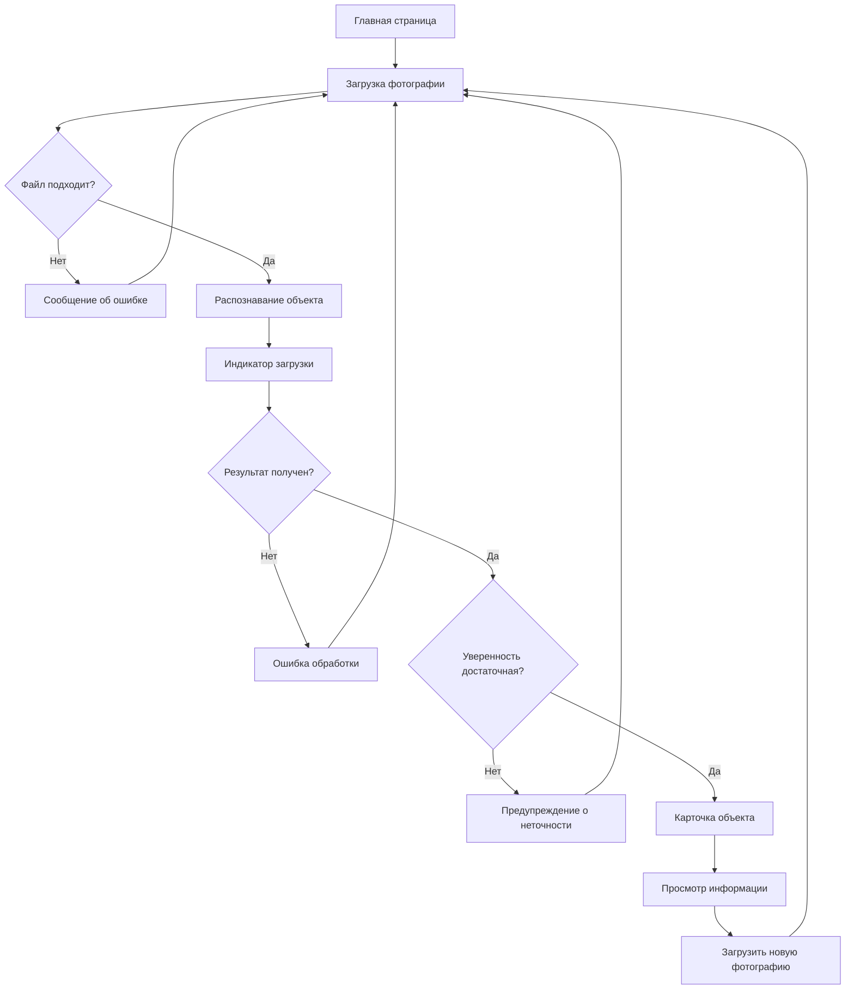

# Бриф ML-продукта Smart Vision

## 1. О проекте

**Название:** Smart Vision.

**Описание:** Smart Vision — веб-приложение на основе искусственного интеллекта для распознавания объектов по фотографии. Пользователь загружает изображение, после чего система определяет объект и предоставляет краткую информацию о нём.

### Команда

| Участник | Роль | За что отвечает |
|---|---|---|
| Пан Олег | Backend-разработчик | Серверная часть и логика приложения |
| Хан Кирилл | ML-разработчик | Подбор и подключение модели распознавания |
| Песковатков Александр | Frontend-разработчик | Интерфейс и взаимодействие с пользователем |

---

## 2. Задача

### Задача

Пользователи часто сталкиваются с незнакомыми предметами, растениями и другими объектами, название которых они не знают. Обычный поиск информации затруднён, поскольку пользователь не может правильно сформулировать поисковый запрос.

### Решение

Создать веб-приложение, позволяющее распознавать объекты по фотографии с помощью готовой модели машинного обучения.

Идеальный результат — пользователь загружает фотографию и за несколько секунд получает название объекта и краткую информацию о нём.

### Полезное действие проекта

Пользователю не нужно самостоятельно искать название незнакомого объекта, описывать его внешний вид и просматривать большое количество сайтов.

### Критерий успеха

Не менее 80% фотографий объектов из поддерживаемых моделью категорий должны быть правильно распознаны на тестовой выборке.

---

## 3. Аудитория

### Основные сегменты

- Обычные пользователи, желающие узнать название незнакомого предмета.
- Студенты и школьники, изучающие окружающий мир.
- Туристы и путешественники.
- Люди, интересующиеся растениями и животными.

Основной сегмент — обычные пользователи, которым необходимо быстро получить информацию о незнакомом объекте.

---

## 4. Job stories

1. Когда я вижу незнакомый предмет, я хочу загрузить его фотографию, чтобы узнать, как он называется.

2. Когда я встречаю незнакомое растение, я хочу распознать его по фотографии, чтобы получить основную информацию о нём.

3. Когда сервис неправильно определяет объект, я хочу загрузить другую фотографию, чтобы получить более точный результат.

---

## 5. ML-часть

| Вопрос | Ответ |
|---|---|
| Какую задачу решает модель? | Классификация изображений — определение категории основного объекта на фотографии. |
| Что пользователь даёт на вход? | Фотографию в формате JPG, JPEG или PNG. |
| Что модель возвращает? | Предполагаемое название объекта и оценку уверенности модели. |
| Как результат показывается пользователю? | В виде карточки с фотографией, названием объекта, кратким описанием и оценкой уверенности. |
| Что будет, если модель ошибётся? | Пользователь может получить неправильную информацию об объекте. |
| Нужно ли показывать уверенность модели? | Да. Необходимо отображать оценку уверенности и предупреждать пользователя о возможной ошибке. |
| Что пользователь может сделать с плохим результатом? | Загрузить другую фотографию и повторить распознавание. |
| Сколько пользователь готов ждать результат? | Предположительно до 5 секунд. Во время обработки отображается индикатор загрузки. |
| Откуда возьмётся модель? | Планируется использовать готовую предобученную модель с платформы Hugging Face. |

Окончательный выбор модели будет сделан после проверки её точности, скорости работы и поддерживаемых категорий объектов.

---

## 6. Основной сценарий (User Flow)

### Последовательность действий

1. Пользователь открывает главную страницу приложения.
2. Нажимает кнопку «Загрузить фотографию».
3. Выбирает изображение на своём устройстве.
4. Нажимает кнопку «Распознать».
5. Система проверяет и обрабатывает изображение.
6. Пользователь видит индикатор загрузки.
7. Модель определяет объект.
8. Система отображает результат распознавания.
9. Пользователь изучает информацию или загружает другую фотографию.

### Обработка ошибок

Если фотография не поддерживается, система показывает сообщение об ошибке и предлагает загрузить другой файл.

Если модель не уверена в результате, система предупреждает пользователя и предлагает повторить распознавание с другой фотографией.

### Схема пользовательского сценария

---

## 7. Границы MVP

MVP — минимальная рабочая версия продукта, которую команда планирует реализовать к концу курса.

| Входит в MVP | Не входит в MVP |
|---|---|
| Веб-интерфейс | Отдельное мобильное приложение |
| Загрузка фотографий | Распознавание видео |
| Распознавание основного объекта | Одновременное распознавание нескольких объектов |
| Отображение названия объекта | Поиск товаров в интернет-магазинах |
| Краткое описание объекта | Голосовой помощник |
| Отображение уверенности модели | Социальные функции |
| Индикатор загрузки | Регистрация и личный кабинет |
| Обработка ошибок | История распознаваний |
| Повторное распознавание | Обучение собственной нейросети с нуля |

---

## 8. Конкуренты и референсы

### Google Lens

Ссылка: https://lens.google/

Преимущества:

- Удобная загрузка изображений.
- Большое количество поддерживаемых объектов.
- Поиск похожих изображений.
- Дополнительная информация об объектах.

Возможные недостатки:

- Большое количество поисковых результатов.
- Отсутствие явной числовой оценки уверенности в обычном сценарии визуального поиска.

### Яндекс — Умная камера

Ссылка: https://yandex.ru/images/

Преимущества:

- Понятный интерфейс.
- Поиск информации по фотографии.
- Поддержка русского языка.
- Поиск похожих изображений и товаров.

Возможные недостатки:

- Результаты могут содержать лишнюю информацию.
- Пользователю иногда приходится самостоятельно искать нужный ответ среди результатов.

### Преимущества Smart Vision

- Минималистичный интерфейс.
- Минимальное количество действий пользователя.
- Отображение основной информации в одной карточке.
- Отображение уверенности модели.
- Возможность быстро повторить распознавание.

Главное предполагаемое преимущество — простота получения результата без необходимости просматривать большое количество поисковых ссылок.

### Референсы

При разработке интерфейса планируется ориентироваться на Google Lens и Умную камеру Яндекса, используя их удачные решения в области загрузки изображений и отображения результатов.

---

## 9. Бренд

### Характер бренда в пяти словах

- Современный.
- Умный.
- Понятный.
- Дружелюбный.
- Технологичный.

### Стиль общения

Smart Vision общается с пользователем простым и понятным языком, избегая сложных технических терминов.

### Основная метафора

Умный объектив, который помогает человеку узнавать окружающий мир.

### Визуальный стиль

- Минималистичный дизайн.
- Светлый фон.
- Синие акцентные цвета.
- Простые и понятные иконки.
- Скруглённые элементы интерфейса.

В качестве визуальных референсов рассматриваются продукты Google и Яндекса.

---

## 10. Гипотезы

### Гипотеза 1

Если сделать загрузку фотографии доступной сразу на главной странице, то пользователь сможет быстрее начать распознавание.

Проверка: измерить время от открытия приложения до загрузки изображения.

### Гипотеза 2

Если отображать уверенность модели, то пользователю будет проще оценивать достоверность результата.

Проверка: провести опрос пользователей после тестирования приложения.

### Гипотеза 3

Если отображать результат в виде одной понятной карточки, то пользователю будет проще получить необходимую информацию.

Проверка: сравнить время поиска нужной информации в Smart Vision и существующих сервисах.

---

## 11. Что ещё важно знать

- Приложение должно корректно работать на компьютерах и смартфонах.
- Загруженные фотографии не должны храниться без необходимости.
- Пользователь должен быть предупреждён о возможных ошибках искусственного интеллекта.
- Сервис не предназначен для медицинской диагностики или определения безопасности неизвестных веществ, растений и грибов.
- Точность распознавания зависит от качества изображения и возможностей выбранной модели.

---

## Подробный портрет целевой аудитории

### Основной сегмент

Обычные пользователи, желающие быстро получать информацию об окружающих предметах.

| Характеристика | Описание |
|---|---|
| Возраст | Предположительно от 16 до 45 лет |
| Устройства | Смартфон, ноутбук, компьютер |
| Технические навыки | Базовый уровень |
| Основная потребность | Узнать название незнакомого объекта |
| Проблема | Сложно описать неизвестный предмет словами |
| Мотивация | Быстро получить необходимую информацию |
| Ожидания | Простой интерфейс и понятный результат |
| Возможные трудности | Некачественная фотография или неправильное распознавание |

## Заключение

Smart Vision — интеллектуальный помощник для распознавания объектов по фотографии.

Основная цель проекта — сделать получение информации об окружающем мире быстрым, простым и доступным с помощью технологий машинного обучения.

